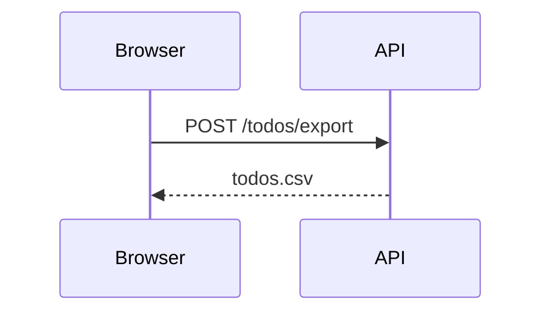

# design.md template

Write `.relay/YYYY-MM-DD-<slug>/design.md` with this structure. Scale each
section to the complexity of the feature: a few sentences when straightforward,
up to a few hundred words when nuanced. Drop a section only when it genuinely
does not apply, and say so in one line rather than leaving a placeholder.

````markdown
---
status: draft
---
# <Feature> — Design

## Problem

The problem from the user's perspective: who has it, when, and what it costs
them today.

## Goal / Non-goals

- Goal: what this feature achieves, in one or two sentences.
- Non-goals: what is explicitly out of scope, so the plan and the reviewer do
  not expand it.

## Constraints

Project-wide requirements that bind the implementation: version floors,
dependency limits, naming and copy rules, platform requirements, performance
budgets, security requirements. One line each, with exact values. relay-plan
copies these verbatim into the plan's Global Constraints.

## Approaches Considered

Two or three approaches, each with its trade-offs. Mark the chosen one and say
why it won. Keep the rejected ones: they are the answer to "why not just…"
during review and implementation.

### A. <name> (chosen)
- How it works
- Pros / cons

### B. <name>
- How it works
- Pros / cons
- Why not

## Design

Architecture, components and their responsibilities, data flow, error
handling, and testing strategy for the chosen approach. For each unit: what it
does, how it is used, what it depends on. Prefer the existing patterns of the
codebase and name the files or modules involved.

When a picture helps (components and their calls, a request across
processes, a state machine), draw it as a Mermaid block following
`references/diagrams.md`, never as ASCII art:



## UI

Only when the feature has a visual component.

Mockups compared, when the design chose between layouts:

- `mockups/option-a.html` — chosen: <reason>
- `mockups/option-b.html` — rejected: <reason>

One row per screen that has a visual reference. The contract, not the
reference, is what the plan's tasks work from (see
`references/ui-contract.md`):

| Screen | Visual reference | Contract | States captured |
|---|---|---|---|
| Todo list | `mockups/option-a.html` | `ui/todo-list.md` | default, row menu open, filters applied, empty |

Rules shared by every screen: `ui/shared.md`.

Deviations from the reference that the user accepted, one line each (the
contracts' Conversions hold the detail): "filter card radius: token radius
instead of the reference's 8px".

A screen with no visual reference is built from the component library's
defaults; say so in one line.

## Decisions

Every decision settled during the interview, one line each, including the
options that were rejected and why. This section is the spec the reviewer
checks the implementation against, so be concrete: values, names, behaviours.

## Open Questions

Anything still unresolved. An approved design should have none; if a question
must stay open, state who decides it and when.
````
