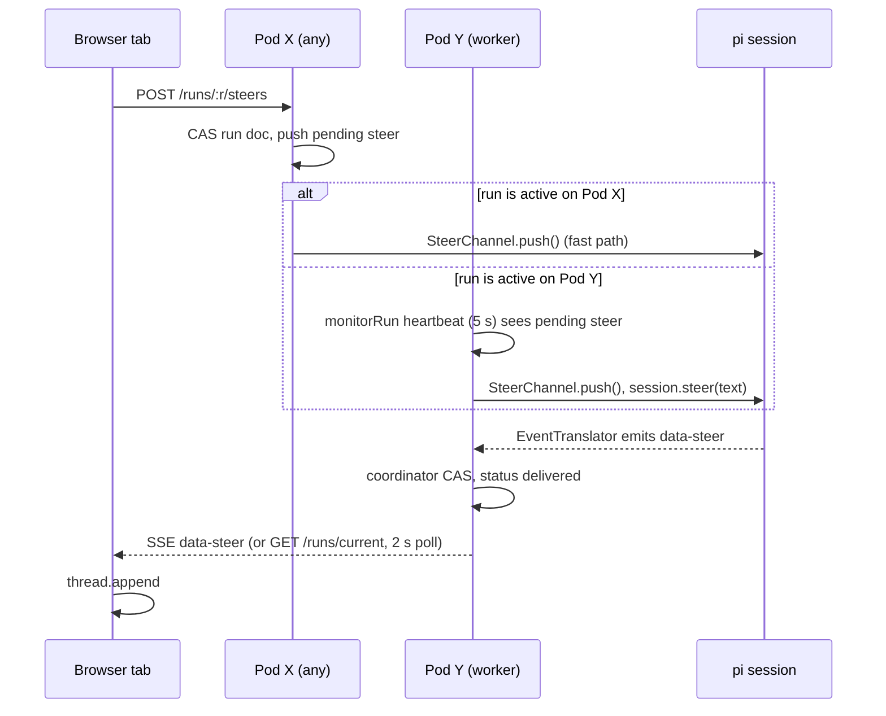
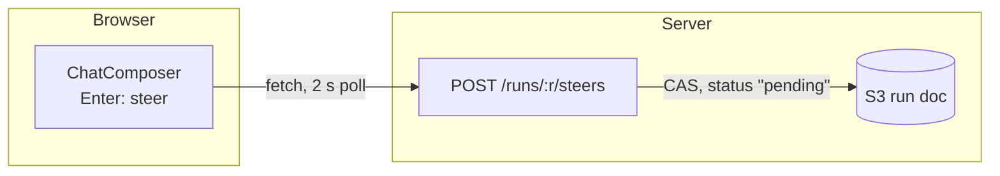

# Diagrams

Every diagram in a relay document (`design.md`, `plan.md`, merge request
descriptions) is a Mermaid block. Never draw with ASCII or box-drawing
characters (`┌─┐`, `│`, `──▶`, `+--+`): they line up only in one font, and
Crit, GitLab and most viewers render them misaligned. Wide glyphs such as
`→`, `▶` and `⌘` break alignment even in monospace.

Draw a diagram only when it says something prose cannot say as quickly:
components and the calls between them, a request crossing several processes,
a state machine. A list of steps is a numbered list; a file layout is the
plan's `**Files:**` list or a nested bullet list, not a tree drawing.

## Pick the type

| What you show | Mermaid type |
|---|---|
| One request or event across processes, in time order | `sequenceDiagram` |
| Components, modules, who calls whom | `flowchart LR` (or `TD`), one `subgraph` per process or host |
| Lifecycle or status transitions | `stateDiagram-v2` |
| Data model and relations | `erDiagram` |
| Types and their relations | `classDiagram` |

Use only these five. Newer types (`architecture-beta`, `block-beta`,
`packet-beta`, …) may not render in GitLab's older Mermaid. A flow with
numbered steps between boxes is almost always a `sequenceDiagram`, not a
flowchart.

## Syntax rules (Crit and GitLab)

Crit renders a block as a diagram only when it is a top-level fenced block
whose info string is exactly `mermaid`; it uses Mermaid 11 with the default
`strict` security level and its own light/dark theme. GitLab renders the same
block. To stay inside what both accept:

- Fence it as ` ```mermaid ` at the top level of the document, unindented.
  Inside a list item, blockquote or another fence, Crit does not render it.
- Quote every label that contains anything beyond letters, digits and spaces:
  `api["POST /runs/:r/steers"]`, `-->|"2 s poll"|`. Unquoted `( ) [ ] { } : ;
  / < > # & |` break the flowchart parser. Inside quotes, write a double quote
  as `#quot;`. Never put `;` in a label or message: it ends a statement.
- Node ids are short ASCII words (`browser`, `podX`, `store`). Never use `end`
  as an id (`End` is fine), and put a space on both sides of every arrow
  (`a --> b`): `a---ob` reads as a circle-ended edge to `b`.
- No `%%{init: …}%%` directives, `classDef`/`style` colours, `click` handlers,
  HTML, or Markdown-string labels: they fight Crit's theme or are stripped by
  the strict security level. A line break inside a label is `<br/>`, nothing
  else.
- Keep one diagram to about 15 nodes or participants; split a larger one.
  Crit shows a Mermaid block as one unit, so a reviewer can comment on the
  diagram but not on a line of it: put the decisions in the prose around it,
  where they can be commented on.

## Examples

A steer request crossing a browser tab and two pods:



The components behind it:



## Check before review

For each diagram: the fence is exactly ` ```mermaid ` at the top level; every
label with punctuation is quoted; no `end` id and no `;` in labels; the type is
one of the five above; about 15 nodes or fewer. Crit shows "Syntax error in
text" in place of a diagram that does not parse, so a broken diagram is a
review finding like any other.
